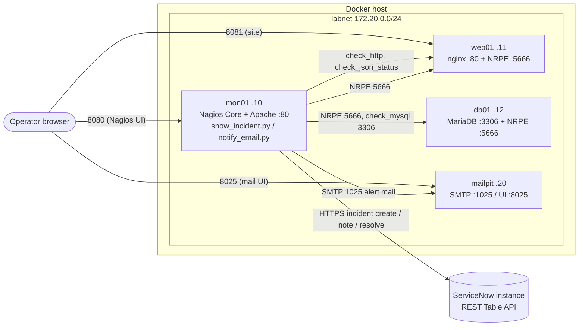
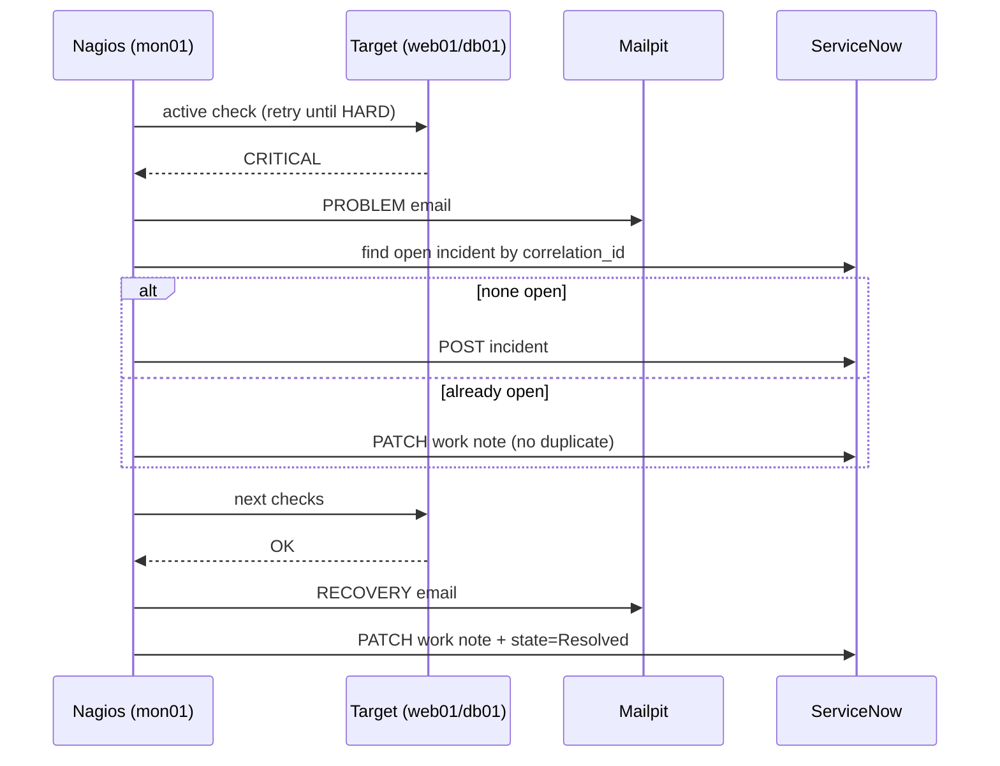

# Architecture

Rendered by GitHub, GitLab, VS Code and any Mermaid-aware viewer. To edit as draw.io:
in diagrams.net use *Arrange > Insert > Advanced > Mermaid* and paste the block below.

## Alert flow

Without `SNOW_*` credentials in `.env` the ServiceNow steps run in dry-run mode (logged only, in
`/var/log/nagios4/lab_notify.log` inside mon01).
